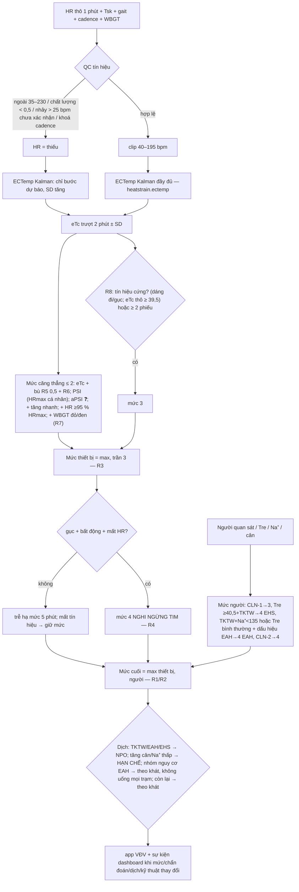

# 02 — Prototype hệ thống cảnh báo nhiều tầng: thiết bị → app → dashboard ban y tế

*Agent:* `algorithm-engineer` · *Ngày:* 2026-10-24 · *Đầu vào:* `01_device-scout_devices.md`, `01_thermo-modeler_models.md`, `01_clinical-advisor_clinical.md`
*Mã nguồn:* `_workspace/02_algorithm-engineer_alert_engine.py` (Python 3, thuần thư viện chuẩn; **import** `heatstrain.py` của skill `core-temp-modeling`, không sửa file nào trong `.claude/`)
*Cấu hình ngưỡng:* `_workspace/02_algorithm-engineer_thresholds.json` (mỗi ngưỡng ghi id dòng CSV của clinical-advisor, nguồn và độ tin cậy)
*Nhật ký chạy thật:* `_workspace/02_algorithm-engineer_sim_log.txt` (281 dòng, sinh bởi `python3 02_algorithm-engineer_alert_engine.py`, Python 3.13.17)

> **CẢNH BÁO PHÁP LÝ:** đây là prototype nghiên cứu, **không phải thiết bị y tế**. Tc ước tính (eTc) chỉ dùng để sàng lọc. Chẩn đoán say nắng gắng sức (EHS) cần **Tre ≥ 40,5 °C + rối loạn TKTW do nhân viên y tế xác nhận** (IOC 2021, PMID 33888465). Mọi ngưỡng gắn ❓/expert phải được hiệu chỉnh bằng dữ liệu thực địa có viên nang nuốt hoặc Tre trước khi dùng. Thuật toán ECTemp có bằng sáng chế của US Army (US10702165B2), nên phải kiểm tra quyền cấp phép trước khi thương mại hoá.

---

## 0. Tóm tắt

1. **Một động cơ chạy trên điện thoại cho mỗi VĐV.** Luồng xử lý: HR (dây ngực hoặc đồng hồ) → kiểm soát chất lượng tín hiệu → clip HR ≤ 195 → ECTemp (`heatstrain.ectemp`) → eTc ± SD, PSI (dùng HRmax cá nhân), aPSI (khi có nhiệt độ da; công thức ❓), tốc độ tăng eTc, HR kéo dài, chỉ số dáng đi → mức thiết bị (**trần 3**) → cộng thêm theo WBGT → gộp với mức do người quan sát, Tre và Na⁺ đặt (**mức cuối = max**) → hướng dẫn dịch → gửi app VĐV và dashboard ban y tế.
2. **Thực thi đủ 7 quy tắc R1–R7 của clinical-advisor, thêm một quy tắc mới R8 (đề xuất ❓).** Các tín hiệu "căng thẳng" chỉ đẩy được tới **mức 2**. Các tín hiệu này gồm eTc đã cộng bù sai số R5, PSI/aPSI và WBGT. Muốn lên **mức 3** cần một trong hai điều kiện:
   - có một tín hiệu cứng: dáng đi mất ổn định hoặc gục ngã, hoặc eTc thô ≥ 39,5 °C;
   - hoặc có **≥ 2 tín hiệu độc lập**.
   Mục đích là giữ độ nhạy do phần bù R5 mang lại mà không làm quá tải đội cơ động.
3. **Kết quả chạy thật trên 4 kịch bản tổng hợp (§5):**
   - **S1 (chạy bình thường, nóng ẩm):** không có báo động mức 3/4. VĐV ở **mức 2 trong 99/121 phút**, tức gánh nặng cảnh báo cao (xem §6).
   - **S2 (EHS, HR bão hoà):** eTc chỉ đạt **39,91 °C khi Tc mô phỏng là 41,3 °C** (đánh giá thấp 1,4 °C). Dù vậy engine vẫn lên **mức 3 ở phút 28**, 52 phút trước khi VĐV gục. Dáng đi được phát hiện ở phút 76, mức 4 EHS ở phút 82 khi có Tre. Hệ chỉ dùng ECTemp (baseline) chỉ lên mức 3 ở phút 67, đúng lúc Tc mô phỏng đã đạt 40,5 °C.
   - **S3 (nhiễu/mất tín hiệu):** QC loại 8 mẫu nhiễu (gai, giá trị 0, khoá nhịp bước). Khi mất tín hiệu 12 phút, hệ giữ mức cũ và báo kỹ thuật. Gục + bất động + mất tín hiệu tim → **mức 4 nghi ngừng tim ngay lập tức (R4)**. Baseline thì báo động giả mức 2 vì các gai HR.
   - **S4 (EAH):** engine **không bao giờ khuyên uống thêm**. Hệ chặn dịch từ lúc cân thấy tăng cân (phút 200) và chuyển sang mức 4 EAH nặng (NaCl 3 %, không làm mát bằng nước, không cho uống) ở phút 294 dựa trên TKTW + Tre 38,4 + dấu hiệu EAH, **trước khi có Na⁺**. Baseline ở mức 0 suốt 311 phút.
   - **Tự kiểm tra bất biến an toàn:** ĐẠT, 0 vi phạm.

---

## 1. Kiến trúc hệ thống

```
 TẦNG 0 — TRƯỚC GIẢI (ban y tế + BTC)
   Dự báo WBGT theo giờ (≥10 năm dữ liệu lịch sử, IOC 2022) ──► chọn giờ xuất phát, cờ dự kiến, bố trí bồn CWI/AED
   Đăng ký VĐV: tuổi, HRrest, HRmax (đo hoặc 220−tuổi), yếu tố nguy cơ (R6), nhóm nguy cơ EAH, đồng ý dữ liệu (Luật BVDLCN 91/2025 + NĐ 356/2025)

 TẦNG 1 — THIẾT BỊ TRÊN NGƯỜI VĐV                       TẦNG 2 — APP ĐIỆN THOẠI VĐV (edge, chạy được offline)
 ┌──────────────────────────────┐   BLE HRS 1 Hz    ┌─────────────────────────────────────────────────────────┐
 │ Dây ngực ECG (ưu tiên) hoặc  │ ───────────────►  │ gộp 1 phút → QC → clip → ECTemp → PSI/aPSI → R1–R8      │
 │ đồng hồ PPG; tuỳ chọn: Tsk   │   ANT+/FIT/API    │ rung/âm báo + thông điệp tiếng Việt (mức 1–3)           │
 │ ngực, gia tốc kế thân (dáng   │                   │ nút "Tôi thấy không ổn" (tự báo triệu chứng)            │
 │ đi, gục), cadence, GPS       │                   │ gửi trạng thái nén mỗi 60 s: id, mức, eTc±SD, lý do, GPS│
 └──────────────────────────────┘                   └──────────────────────┬──────────────────────────────────┘
                                                                              │ 4G/5G (dự phòng: SMS/LoRa ❓)
 TRẠM WBGT dọc đường (Kestrel 5400 hoặc tương đương, 1,2–1,5 m) ──────────────┤ WBGT trung bình 15 phút → mọi VĐV gần trạm
 APP QUAN SÁT VIÊN / TNV: nút CLN-1 (TKTW), CLN-2 (không đáp ứng), CLN-3,     │
   nôn/đau đầu, cân tại trạm (SCR-W1/W2) ─────────────────────────────────────┤ (R1, R2: không bao giờ bị thiết bị hạ mức)
 KHU XỬ TRÍ NHIỆT / TRẠM Y TẾ: nhập Tre (DX-T*), Na⁺/glucose POC (LAB-*) ─────┤
                                                                              ▼
 TẦNG 3 — DASHBOARD BAN Y TẾ (máy chủ giải + tablet điều phối)
   • danh sách VĐV xếp theo mức 4→1, bản đồ GPS, đồng hồ đếm "mục tiêu thời gian" (≤3–5 phút…)
   • mỗi sự kiện gồm: ai làm – làm gì – trong bao lâu (DASH_ACTION/DX_ACTION) + lý do + độ tin cậy eTc + hướng dẫn dịch
   • vòng xác nhận: người tới nơi bấm "xác nhận / huỷ / đã chuyển khu xử trí" → ghi log (để hiệu chỉnh độ nhạy/đặc hiệu sau giải)
   • cờ kỹ thuật: mất tín hiệu ≥3 phút (giữ mức), ≥10 phút (cử quan sát viên kiểm tra trực tiếp)
   • panel khu xử trí nhiệt: theo dõi tốc độ làm mát (DX-T5), ngưỡng ngừng làm mát 39,0 °C (DX-T3), chuyển viện (DX-T6)
```

**Lý do đặt engine trên điện thoại:**
- Mạng di động tại giải chạy đông người dễ nghẽn. Nếu engine chạy tại chỗ, VĐV vẫn nhận được cảnh báo mức 1–3 khi mất kết nối.
- Dashboard chỉ cần trạng thái nén, khoảng 200 byte mỗi phút cho mỗi VĐV.
- ECTemp chỉ cần HR 1 phút, nên chi phí tính toán không đáng kể.
- Nhược điểm: mỗi VĐV phải mang điện thoại. Phương án thay thế là đồng hồ có Connect IQ, hoặc dây ngực truyền qua cổng thu (gateway) BLE đặt dọc đường ❓.

## 2. Sơ đồ luồng quyết định (mỗi phút, mỗi VĐV)



## 3. Mô hình và tín hiệu (tái sử dụng skill)

| Thành phần | Hàm | Ghi chú |
|---|---|---|
| ECTemp bậc 2 (Buller 2013) | `heatstrain.ectemp(hr_series, params={"v0":…}, tc0=…)` | Hệ số đã được thermo-modeler đối chiếu (khớp). Tc0 = 37,1 °C với v0 = 0,02 khi Tc0 là giá trị giả định (de Korte 2022), hoặc v0 = 0 khi Tc0 đo được. Mỗi phút chạy lại toàn chuỗi (n ≤ 300, chi phí không đáng kể) để dùng đúng thư viện của skill. |
| Clip HR | engine | Đỉnh parabol ECTemp khoảng 195 bpm tại 42,05 °C. Khi HR > 185, hệ gắn cờ "độ tin cậy thấp" (thermo-modeler §1.1, §7.1). |
| PSI (Moran 1998) | `heatstrain.psi(..., hr_max=HRmax cá nhân)` | Dùng eTc thay cho Tre nên sai số eTc dồn vào PSI. |
| aPSI | `heatstrain.psi(..., tc_max=Tc_crit, hr_max=0,9·(220−tuổi))` với Tc_crit = 39,5 + ((eTc − Tsk) − 4)/4, kẹp trong khoảng 38,5–40,5 | **Công thức ❓ chưa kiểm chứng** (thermo-modeler §5.2, chỉ có đoạn trích sáng chế). Chỉ bật khi có Tsk; có thể tắt bằng `apsi.enabled`. |
| Dáng đi | đầu vào `gait` ∈ [0,1] do lớp xử lý gia tốc kế tính trước | Thuật toán dáng đi cụ thể của Buller 2022 chưa công khai ❓. Prototype nhận chỉ số đã chuẩn hoá. Ngưỡng 0,6 kéo dài ≥ 2 phút là đề xuất ❓. |
| Baseline so sánh | `heatstrain.run()` | Dùng HR thô, không QC, không clip, với ngưỡng mặc định của thư viện. Đây là "hệ chỉ dựa vào ECTemp". |

## 4. Cấu hình ngưỡng (trích từ `02_algorithm-engineer_thresholds.json`)

| Khoá | Mặc định | Nguồn / độ tin cậy |
|---|---|---|
| `etc_levels` SCR-T1…T4 | 38,5→1; 39,0→2; 39,5→3; 40,0→3 (không tự lên 4) | CSV clinical; Gribok 2010 PMID 20371418 — expert ❓ |
| `etc_safety_offset_c` (R5) | +0,5 °C cộng vào eTc trước khi so ngưỡng | R5; Hunt 2019 (ECTemp 38,4 ↔ Tc 39,0); de Korte 2022 (độ nhạy 4 % tại > 39,5) |
| R6 yếu tố nguy cơ | −0,3 °C/yếu tố (tối đa −0,6); PSI −0,5/yếu tố (tối đa −1) | R6 — expert ❓ |
| `rise_rate` SCR-R1 | ≥ 0,5 °C/10 phút → +1 (trần 3 qua R8); **chỉ xét khi eTc ≥ 38,5** | expert ❓. Sàn 38,5 được thêm sau khi chạy thử: ở pha khởi động, Tc tăng ~0,05 °C/phút là sinh lý và gây báo động giả ở S1/S2 (§6) |
| `psi` SCR-P1/P2 | ≥ 7→2; ≥ 9→3 (HRmax cá nhân) | Moran 1998 PMID 9688970; ngưỡng expert ❓ |
| `apsi` | ≥ 7→2; ≥ 9→3 | Buller 2023 PMID 37703905 — công thức ❓ |
| `hr_sustained` SCR-H1 | ≥ 95 % HRmax kéo dài > 10 phút → +1 (trần 2) | expert ❓ |
| `gait` SCR-G1 | chỉ số ≥ 0,6 trong ≥ 2 phút → 3 (coi là nghi TKTW, R2) | Buller 2022 doi:10.1136/bjsports-2021-104081 |
| `cardiac` SCR-H2 | gục + bất động + mất HR → 4 | R4; Kim 2012 PMID 22236223 |
| `wbgt_flags` ENV-0…3 | < 18 xanh; ≥ 18 vàng; ≥ 23 đỏ; > 28 đen | ACSM 1996 ◐ |
| `wbgt_bump` (R7) | cờ đỏ/đen → +1 nếu mức cá nhân ≥ 1 | R7 — expert ❓ |
| `level3_rule` (R8, **mới**) | trần mức căng thẳng = 2. Lên mức 3 khi có tín hiệu cứng, hoặc ≥ 2 phiếu trong {eTc + bù ≥ 39,5; PSI hoặc aPSI ≥ 9 (tính 1 phiếu); tăng nhanh; HR kéo dài; WBGT đen} | Đề xuất của algorithm-engineer ❓, dựa trên Buller 2022, Davey 2021 và IOC 2022 (nhiều VĐV > 40 °C không có triệu chứng) |
| `device_level_cap` (R3) | 3 | R3 |
| `deescalate_after_min` | thiết bị chỉ hạ mức sau 5 phút liên tục dưới ngưỡng | expert ❓ |
| `signal_qc` | HR hợp lệ 35–230; nhảy > 25 bpm/phút phải được 2 mẫu liên tiếp xác nhận; khoá cadence: \|HR − cadence\| ≤ 3 kèm nhảy ≥ 10; chất lượng thiết bị < 0,5 → loại; mất ≥ 3 phút → giữ mức; mất ≥ 10 phút → cử quan sát viên | expert ❓ |
| `clinical` | Tre EHS 40,5; ngừng làm mát 39,0; tốc độ làm mát < 0,15 °C/phút → cảnh báo quy trình (sau 5 phút) | IOC 2021 ✅; ACSM ◐ |
| `eah` | Na⁺ < 135 → 2; TKTW + Na⁺ < 135 → 4; Na⁺ < 125 → 4; "Tre bình thường/tăng nhẹ" < 39,5 ❓ | WMS 2019 PMID 32044213; Hew-Butler 2015 PMID 26102445 |

**Hướng dẫn dịch** (chặn lời khuyên "uống nước" theo ngữ cảnh):

| Trạng thái | Điều kiện | Thông điệp |
|---|---|---|
| `THIRST` | mặc định | uống theo cảm giác khát, không uống ép |
| `THIRST_EAH_RISK` | hồ sơ thuộc nhóm nguy cơ EAH (chạy chậm, marathon đầu tiên, uống ở mọi trạm) | chỉ uống khi khát; KHÔNG uống ở mọi trạm |
| `RESTRICT` | tăng cân trong giải (SCR-W1) hoặc Na⁺ < 135 | KHÔNG uống thêm nước lọc/dịch nhược trương; báo trạm y tế làm Na⁺ |
| `NPO` | có dấu hiệu TKTW (người báo hoặc dáng đi), EHS, EAH nặng, nghi ngừng tim | KHÔNG cho uống cho tới khi có Na⁺ và loại trừ EAH (IOC 2021; WMS 2019) |

Ghi chú về thư viện skill: nhãn mức 2 trong `heatstrain.DEFAULT_THRESHOLDS` là "CẢNH GIÁC – giảm cường độ, **uống nước**…", không xét đến EAH. Engine không dùng các nhãn này. **Đề nghị** cập nhật skill để bỏ lời khuyên uống nước vô điều kiện (ghi nhận ở đây, không tự sửa `.claude/`).

## 5. Kết quả mô phỏng (chạy thật)

Lệnh chạy: `cd _workspace && python3 02_algorithm-engineer_alert_engine.py` (mã thoát 0). Seed cố định = 7, nên kết quả tái lập được. **Dữ liệu là tổng hợp:** "Tc mô phỏng" là quỹ đạo giả định dùng để so sánh, không phải số đo. HR được sinh độc lập với mô hình quan sát của ECTemp, nên mô phỏng không bị vòng lặp (ECTemp không "tự đoán đúng" dữ liệu do chính nó sinh ra).

### 5.1 Bảng tổng hợp

| Kịch bản | Mức tối đa engine / baseline | Phút ở mức 0/1/2/3/4 (engine) | Đầu tiên ≥ 2 / ≥ 3 / 4 (engine) | Đầu tiên ≥ 2 / ≥ 3 (baseline) | Đỉnh Tc mô phỏng / đỉnh eTc | Bias eTc − Tc, RMSE (trước gục/đo Tre) |
|---|---|---|---|---|---|---|
| S1 bình thường, WBGT 26→28 | 2 / 2 | 22/0/99/0/0 | p22 / — / — | p59 / — | 38,98 / 39,09 | +0,04; 0,10 °C |
| S2 EHS, HR bão hoà, WBGT 28,5 | **4 / 3** | 11/0/17/57/16 | p11 / **p28** / p82 | p26 / **p67** | **41,30 / 39,91** | **−0,30; 0,59 °C** |
| S3 nhiễu + mất tín hiệu + gục | **4 / 2** | 24/0/66/0/6 | p24 / p90 / **p90** | p15 (gai nhiễu) / — | 38,88 / 38,90 | −0,05; 0,12 °C |
| S4 EAH, WBGT 24→29 | **4 / 0** | 46/0/244/4/17 | p46 / p290 / **p294** | — / — | 38,23 / 38,32 | +0,04; 0,08 °C |

Trong S2, Tc mô phỏng đạt 39,5 °C ở phút 50 và 40,5 °C ở phút 67. VĐV gục ở phút 80.

### 5.2 S1 — Chạy bán marathon bình thường trong điều kiện nóng ẩm

**Hồ sơ:** 35 tuổi, HRrest 62, HRmax 186, không có yếu tố nguy cơ. HR 148–160 bpm trong 120 phút. WBGT 26,0→28,0 (cờ đỏ).

```
     0 | HR   69→ 69 | eTc 37.07±0.14 | PSI  0.2 | aPSI  0.3 | WBGT 26.0 | mức 0 (BÌNH THƯỜNG) TB 0/Người 0 | dịch THIRST
    22 | ... eTc 38.02 ... mức 2 (CẢNH BÁO)
  [phút 22] MỨC 2 CẢNH BÁO · ai: VĐV + người quan sát · mục tiêu: ≤5 phút
      app VĐV  : Giảm tốc rõ hoặc đi bộ; người quan sát sẽ tới hỏi thăm. Dịch: uống theo cảm giác khát, không uống ép.
      lý do    : SCR-T1: eTc 38.02±0.10 °C (ngưỡng quyết định 38.52 sau bù R5/R6) | R7: WBGT 26.4 °C (cờ ĐỎ) +1
   120 | HR  159→159 | eTc 39.09±0.12 | PSI  8.1 | aPSI  8.7 | WBGT 28.0 | mức 2 ...
```

**Nhận xét:**
- Không có cảnh báo mức 3 hoặc 4.
- VĐV ở mức 2 trong 99/121 phút. Nguyên nhân là phần bù R5 (+0,5 °C) cộng với R7 (cờ đỏ +1).
- Theo đúng bảng của clinical-advisor, Tc mô phỏng thật (lên tới 38,98) cũng gần ngưỡng SCR-T2 39,0. Vì vậy ở WBGT đỏ, phần lớn người chạy bình thường sẽ ở mức 2. Điều này phù hợp với dữ liệu thực địa ở Singapore: Tc đỉnh 39,4 ± 0,6 °C ở người chạy phong trào (Sakamoto 2026).

### 5.3 S2 — Tiến triển tới EHS khi HR bão hoà

**Hồ sơ:** 24 tuổi, HRrest 50, HRmax 194, có 1 yếu tố nguy cơ (vừa bị tiêu chảy). WBGT 28,5 (cờ đen).

**Diễn biến mô phỏng:**
- HR bão hoà ở 187–190 bpm từ phút 50, trong khi Tc mô phỏng tiếp tục tăng 0,06 °C/phút tới 41,3.
- Dáng đi mất ổn định từ phút 70.
- Người quan sát báo TKTW ở phút 77; VĐV gục ở phút 80; đo Tre 41,3 ở phút 82.
- Ngâm nước lạnh (CWI) từ phút 83.

```
  [phút  50] HR thô  188 | Tc mô phỏng 39.50 | engine eTc 39.32 mức 3 | baseline eTc 39.06 PSI 9.39 mức 2 'CẢNH GIÁC – giảm cường độ, uống nước, ng'
  [phút  67] HR thô  189 | Tc mô phỏng 40.52 | engine eTc 39.69 mức 3 | baseline eTc 39.52 PSI 10.38 mức 3 'CAO – dừng vận động, làm mát, theo dõi s'
  [phút  80] HR thô  178 | Tc mô phỏng 41.30 | engine eTc 39.91 mức 3 | baseline eTc 39.77 PSI 10.49 mức 3 'CAO – dừng vận động, làm mát, theo dõi s'
  [phút 28] MỨC 3 NGUY CƠ CAO · ai: Đội cơ động · mục tiêu: ≤3–5 phút
      lý do    : SCR-T2: eTc 38.65±0.11 °C (ngưỡng quyết định 39.45 sau bù R5/R6) | SCR-P1: PSI 7.7 | APSI-2: aPSI 8.5 (...) | R8 mức 3: 2 tín hiệu độc lập: PSI/aPSI ≥ 9, WBGT cờ ĐEN
  [phút 76] MỨC 3 ... lý do: ... SCR-G1: dáng chạy mất ổn định 2 phút (chỉ số 0.80) → coi như nghi TKTW (R2) ... ; app VĐV: ... Dịch: KHÔNG cho uống cho tới khi có Na⁺ và loại trừ EAH
  [phút 77] MỨC 3 NGUY CƠ CAO · CNS_UNEXPLAINED  (CLN-1/R2: dấu hiệu TKTW do người quan sát báo)
  [phút 82] MỨC 4 CẤP CỨU · EHS · làm mát ngay; hạ nhiệt ≤30 phút từ lúc gục
      hành động: EHS: ngâm nước lạnh toàn thân (CWI 5–15 °C, khuấy) NGAY; theo dõi Tre liên tục; 4 người/bồn; làm Na⁺ + glucose khi không gián đoạn làm mát
  [phút 88] MỨC 4 · EHS · hành động: DX-T5: tốc độ làm mát 0.10 °C/phút < 0.15 → kiểm tra nước đủ lạnh, ngâm thân, khuấy
  [phút 94] MỨC 4 · EHS · hành động: Làm mát đạt 0.16 °C/phút; tiếp tục tới Tre 39.0
  [phút 98] MỨC 3 · EHS · hành động: DX-T3: Tre 39.0 ≤ 39.0 → NGỪNG làm mát, lau khô, theo dõi Tre ≥15 phút, ngâm lại nếu tăng; chuẩn bị chuyển viện (DX-T6)
```

**Nhận xét:**
- **ECTemp bão hoà, đúng như cơ chế thermo-modeler đã mô tả.** Khi Tc mô phỏng là 40,5, eTc chỉ là 39,69. Khi Tc mô phỏng là 41,3, eTc chỉ là 39,91. Bias −0,30 °C và RMSE 0,59 °C. Hệ chỉ dùng ECTemp lên mức 3 ở phút 67, cùng lúc Tc mô phỏng chạm 40,5.
- **Engine phát hiện sớm hơn nhờ ba yếu tố:** phần bù R5, yếu tố nguy cơ R6, và quy tắc R8 (aPSI cộng WBGT đen). Engine lên mức 3 sớm hơn baseline 39 phút.
- **Lời khuyên dịch:** nhãn mức 2 của baseline vẫn ghi "uống nước" ở phút 50, trong khi VĐV đang tiến tới EHS.
- **Dáng đi:** tầng dáng đi bắt được ca ở phút 76, tức 4 phút trước khi gục. Cần nói rõ đây là kết quả theo cách dựng kịch bản, không phải độ nhạy đã kiểm định.
- **Làm mát:** cảnh báo quy trình DX-T5 ở phút 88 phản ánh hiện tượng Tre đi ngang ở đầu quá trình làm mát (IOC 2021). Nên cân nhắc tăng thời gian chờ (grace) lên quá 5 phút.

### 5.4 S3 — Nhiễu và mất tín hiệu HR (đồng hồ PPG), cuối kịch bản gục và mất tín hiệu tim

**Thiết lập:** dùng dữ liệu S1, rồi tiêm các lỗi sau:
- gai HR 238 ở phút 15, giá trị 0 ở phút 22, gai 205 ở phút 31;
- khoá theo nhịp bước (HR ≈ cadence 168) ở phút 40–44;
- mất tín hiệu ở phút 55–66;
- từ phút 90: gục, bất động, mất HR.

```
-- Mẫu HR bị QC loại: p15: ngoài miền sinh lý (238); p22: ngoài miền sinh lý (0); p31: bước nhảy bất thường (145→205);
   p40–p44: nghi khoá theo nhịp bước (HR 167–168 ≈ cadence 168, nhảy từ 148)
  [phút  15] HR thô  238 | ... engine eTc 37.71 mức 0 | baseline eTc 37.50 PSI 8.29 mức 2 'CẢNH GIÁC – giảm cường độ, uống nước, ng'
  [phút  22] HR thô    0 | ... engine eTc 37.97 mức 0 | baseline eTc 37.62 PSI -1.54 mức 0
  [phút  42] HR thô  168 | ... engine eTc 38.38 mức 2 | baseline eTc 38.32 PSI 7.04 mức 2 'CẢNH GIÁC – ...'
  [phút 57] MỨC 2 ... kỹ thuật : MẤT TÍN HIỆU HR 3 phút: giữ mức cũ, không hạ mức
  [phút 64] MỨC 2 ... kỹ thuật : MẤT TÍN HIỆU HR 10 phút: eTc chỉ dự báo (SD 0.13); quan sát viên kiểm tra trực tiếp VĐV + thiết bị
  [phút 90] MỨC 4 CẤP CỨU · CARDIAC · CPR ngay; sốc điện ≤3–5 phút ❓
      hành động: NGHI NGỪNG TIM: điều đội AED gần nhất; người chứng kiến CPR ngay; loại trừ tim TRƯỚC xử trí nhiệt (R4, IOC 2021)
  [phút  90] ... baseline eTc 38.88 PSI None mức 1 'THEO DÕI – tăng tần suất kiểm tra'
```

**Nhận xét:**
- QC loại toàn bộ 8 mẫu nhiễu.
- Baseline phát 2 lần báo động giả mức 2 do nhiễu: gai 238 ở phút 15 và gai 205 ở phút 31. Baseline cũng nâng eTc trong lúc HR bị khoá theo cadence.
- Khi mất tín hiệu, Kalman chỉ chạy bước dự báo: SD tăng từ 0,12 lên 0,13 và eTc giữ ở 38,57. Hệ **không hạ mức**.
- Gục kèm mất HR được xử lý như ngừng tim (mức 4) ngay trong phút đầu tiên, trong khi baseline chỉ ở mức 1.
- **Hạn chế:** dữ liệu ở độ phân giải 1 phút, nên tiêu chí "≥ 10–20 giây" của SCR-H2 phải được xử lý ở tầng thiết bị 1 Hz.

### 5.5 S4 — Hạ natri máu do gắng sức (EAH): hệ thống không khuyên uống thêm

**Hồ sơ:** nữ 45 tuổi, HRrest 66, HRmax 175. Thuộc nhóm nguy cơ EAH: marathon đầu tiên, chạy khoảng 5 giờ 30 phút, uống ở mọi trạm.

**Diễn biến:**
- Cân tại trạm km 30 (phút 200): **+1,8 %**.
- Phút 290: lú lẫn, nôn, đau đầu.
- Phút 294: Tre 38,4 °C.
- Phút 299: Na⁺ 127 mmol/L.

```
  [phút 0] MỨC 0 · app VĐV: Dịch: chỉ uống khi khát; KHÔNG uống ở mọi trạm (thuộc nhóm nguy cơ hạ natri máu).
  [phút 46] MỨC 2 · lý do: SCR-T1: eTc 38.00 (ngưỡng quyết định 38.50 sau bù R5/R6) | R7: WBGT 24.7 °C (cờ ĐỎ) +1
  [phút 200] MỨC 2 · app VĐV: Giảm tốc rõ hoặc đi bộ; ... Dịch: KHÔNG uống thêm nước lọc/dịch nhược trương; báo trạm y tế làm Na⁺ (nghi nguy cơ EAH).
      lý do: ... SCR-W1: tăng cân +1.8 % trong giải → nguy cơ EAH
  [phút 290] MỨC 3 · CNS_UNEXPLAINED · Dịch: KHÔNG cho uống cho tới khi có Na⁺ và loại trừ EAH (IOC 2021; WMS 2019).
  [phút 294] MỨC 4 CẤP CỨU · EAH_SEVERE · bolus đầu ngay khi nghi ngờ
      hành động: EAH NẶNG (nghi/xác định): NaCl 3 % 100 mL TM bolus, nhắc lại mỗi 10 phút tối đa 3 lần; KHÔNG truyền dịch nhược trương, KHÔNG cho uống nước; chuyển viện
      lý do: ... LAB-NA2: TKTW, chưa có Na⁺, Tre 38.4 bình thường/tăng nhẹ + dấu hiệu EAH → xử trí như EAH nặng
  [phút 299] MỨC 4 · EAH_SEVERE (LAB-NA2: TKTW + Na⁺ 127 → EAH nặng — xác nhận)
  [phút 290/294] baseline eTc 38.22/38.16 PSI 4.35/4.31 mức 0 'BÌNH THƯỜNG'
```

**Nhận xét:**
- eTc và PSI hoàn toàn "bình thường" (eTc khoảng 38,2), nên **mọi hệ chỉ dựa vào cảm biến đều bỏ sót EAH**: baseline ở mức 0 suốt 311 phút.
- Engine bắt được ca nhờ ba nguồn: hồ sơ nguy cơ, cân tại trạm và quan sát viên.
- Engine phân biệt EAH với EHS bằng Tre bình thường kèm dấu hiệu EAH, nên **không ra lệnh ngâm nước lạnh (CWI)** và **chặn mọi lời khuyên uống** ngay từ phút 200.

### 5.6 Phân tích độ nhạy cấu hình (chạy thật)

```
  A. Mặc định (CSV clinical + R5 bù 0,5 + R7 đỏ/đen + R8)    S1 ≥2:  99 ph, ≥3:   0 ph | S2 đầu ≥2: p11, ≥3: p28 (sớm 52 ph trước gục)
  B. R7 chỉ cộng khi cờ ĐEN                                  S1 ≥2:  82 ph, ≥3:   0 ph | S2 đầu ≥2: p11, ≥3: p28 (sớm 52 ph trước gục)
  C. B + PSI/aPSI ngưỡng 8/10 (VĐV)                          S1 ≥2:  76 ph, ≥3:   0 ph | S2 đầu ≥2: p11, ≥3: p30 (sớm 50 ph trước gục)
  D. Không bù R5 (offset 0)                                  S1 ≥2:  82 ph, ≥3:   0 ph | S2 đầu ≥2: p14, ≥3: p28 (sớm 52 ph trước gục)
  E. Mặc định, tắt aPSI (thiết bị không có Tsk)              S1 ≥2:  99 ph, ≥3:   0 ph | S2 đầu ≥2: p11, ≥3: p30 (sớm 50 ph trước gục)
  F. Chỉ HR (không Tsk, không gia tốc)                       S1 ≥2:  99 ph, ≥3:   0 ph | S2 đầu ≥2: p11, ≥3: p30 (sớm 50 ph trước gục)
  G. R8 không tính phiếu WBGT đen                            S1 ≥2:  99 ph, ≥3:   0 ph | S2 đầu ≥2: p11, ≥3: p30 (sớm 50 ph trước gục)
  H. Chỉ HR + R8 không tính WBGT                             S1 ≥2:  99 ph, ≥3:   0 ph | S2 đầu ≥2: p11, ≥3: p40 (sớm 40 ph trước gục)
```

**Phiên bản trước khi thêm R8 và sàn 38,5 cho tốc độ tăng** (lần chạy đầu, giữ lại để minh bạch): S1 có **82/121 phút ở mức 3**, tức "dừng chạy" với một người chạy bình thường. Nguyên nhân là các bậc cộng chồng lên nhau: tăng nhanh ở pha khởi động, aPSI ≥ 7, và R7 với cờ đỏ. Đây là lý do đưa ra R8.

## 6. Diễn giải và khuyến nghị

1. **Gánh nặng mức 2 là vấn đề vận hành lớn nhất.** Ở WBGT đỏ, ngưỡng của bảng clinical cộng phần bù R5 khiến hầu hết VĐV ở mức 2 trong 65–80 % thời gian (cả 8 biến thể đều như vậy). Có hai lựa chọn:
   - (a) định nghĩa lại mức 2 thành "theo dõi thụ động": người quan sát chỉ nhìn khi VĐV đi ngang qua, không tiếp cận chủ động;
   - (b) hiệu chỉnh ngưỡng theo dữ liệu viên nang thu được ở giải Việt Nam.

   Không nên giảm độ nhạy mức 3 để đổi lấy gánh nặng mức 2 thấp hơn.
2. **Không có biến thể nào gây mức 3 giả trong S1.** Mọi biến thể vẫn cảnh báo mức 3 ở S2 từ 40 phút trở lên trước khi gục. Lưu ý đây là dữ liệu tổng hợp, trong đó HR vẫn tăng theo Tc tới khoảng phút 50. Trong thực tế, HR và Tc có thể tách rời (mất nước, VĐV ưu tú: de Korte 2022), khi đó tầng HR sẽ kém hơn nhiều.
3. **Thứ tự ưu tiên đầu tư cảm biến** (theo bằng chứng, không theo mô phỏng):
   - người quan sát dọc đường cùng app nhập triệu chứng (R1/R2) — rẻ nhất và bắt được cả EAH;
   - gia tốc kế thân để phát hiện dáng đi và gục ngã (Buller 2022: 6/6 ca);
   - Tsk ngực cho aPSI, sau khi đã xác minh công thức (Buller 2025: 86,7 % so với 23,3 % của ECTemp);
   - HR (dây ngực ưu tiên hơn PPG).
4. **Không bao giờ chỉ dựa vào eTc.** S2 cho thấy eTc đánh giá thấp 1,4 °C tại thời điểm gục. S4 cho thấy eTc không nói gì về EAH.

## 7. Giới hạn

- **Dữ liệu tổng hợp:** chưa có dữ liệu thật của VĐV Việt Nam. Các con số "phát hiện sớm X phút" chỉ minh hoạ logic, **không phải độ nhạy hay độ đặc hiệu**.
- **aPSI:** công thức chưa kiểm chứng ❓.
- **Chỉ số dáng đi:** là đầu vào giả định ❓. Chưa hiện thực hoá thuật toán gia tốc kế.
- **R8, sàn tốc độ tăng 38,5 và các tham số QC:** là đề xuất của kỹ sư, cần clinical-advisor duyệt.
- **Phiên bản ECTemp:** dùng bản bậc 2. Bản sigmoid chưa có hệ số ❓. Engine dễ thay hàm quan sát qua `heatstrain`.
- **Độ phân giải 1 phút:** phát hiện ngừng tim cần xử lý ở 1 Hz tại thiết bị.
- **Ngoài phạm vi prototype:** pháp lý về dữ liệu sức khoẻ (Luật BVDLCN 91/2025 + NĐ 356/2025), phân loại trang thiết bị y tế (NĐ 98/2021), và bằng sáng chế ECTemp/aPSI.

## 8. Kế hoạch kiểm định đề xuất

1. **Nghiên cứu hiệu chỉnh thực địa:**
   - Đối tượng: 30–50 VĐV Việt Nam, giải 10–21 km trong điều kiện WBGT ≥ 26.
   - Thiết bị: viên nang e-Celsius/CorTemp, dây ngực HR, Tsk ngực, gia tốc kế thân.
   - Phân tích: Bland–Altman cho phép đo lặp; RMSE theo từng người; độ nhạy/đặc hiệu tại các ngưỡng eTc 38,0–39,5 (bảng kiểu de Korte 2022); kiểm định chéo leave-one-subject-out.
2. **Ghi log mọi cảnh báo và kết cục lâm sàng** (Tre, Na⁺, chẩn đoán cuối) để hiệu chỉnh tham số expert sau mỗi giải. Mục tiêu: độ nhạy mức 3 ≥ 90 % với tỷ lệ dương tính giả chấp nhận được (6–15 % theo Buller 2022/2025).
3. **Hiệu chỉnh tham số:** hiệu chỉnh lại b0–b2 của ECTemp hoặc tham số sigmoid. Thử thêm mô hình HR + Tsk (Welles 2018) khi có dữ liệu.

## 9. Cách chạy

```bash
cd _workspace
python3 02_algorithm-engineer_alert_engine.py                 # 4 kịch bản + phân tích độ nhạy + tự kiểm tra (mã thoát 0 = đạt)
python3 02_algorithm-engineer_alert_engine.py --json out.json # thêm xuất JSON đầy đủ
python3 02_algorithm-engineer_alert_engine.py csv data.csv --age 30 --hr-rest 60 --hr-max 190
#   CSV: minute,hr[,t_skin,gait,cadence,wbgt,hr_quality]
```

API: `AlertEngine(profile, cfg).step(minute, obs) -> dict`. Các trường của `obs`:
- tín hiệu thiết bị: `hr`, `hr_quality`, `cadence`, `t_skin`, `gait`, `collapse`, `immobile`, `wbgt`;
- nhập từ người: `cns`, `exhaustion`, `vomiting`, `headache`, `unresponsive_not_breathing`, `muscle_symptoms`, `weight_change_pct`;
- nhập từ trạm y tế: `tre`, `na`, `cooling_started`, `clear` (chỉ nhân viên y tế mới được xoá).

`evidence-verifier` có thể đối chiếu hệ số với nguồn qua `ECTEMP_PARAMS` trong `heatstrain.py` và các trường `src`/`rel` trong file JSON.
